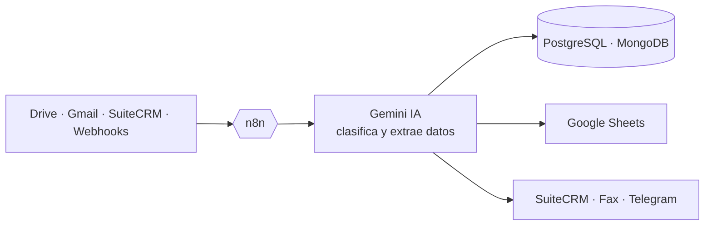

 

---

## 👨‍💻 Sobre mí

Full Stack Developer con **más de 5 años de experiencia** construyendo sistemas escalables y de alto rendimiento. Me especializo en **Angular, TypeScript, NestJS, Laravel y WordPress**, lidero el área de **automatizaciones (n8n, Power Automate e IA)** y gestiono infraestructura en **AWS**.

- ⚡ Optimicé sistemas legacy con mejoras de hasta **35 %** en tiempos de respuesta
- 🏢 Proyectos corporativos para clientes como **Netwey** y **MIT**
- 🧱 Arquitectura limpia y principios **SOLID**
- 🤖 Flujos de trabajo asistidos por IA (Gemini, Claude Code) que reducen tiempos de entrega

---

## 💼 Experiencia

| Rol | Empresa | Periodo |
|---|---|---|
| Semi Senior Developer | **Leadbox** 🇨🇦 | Sep 2026 – Actualidad |
| Web Developer & Head of Automation | **QSM (Quantum Spot Media)** | Jul 2025 – Actualidad |
| Full Stack Developer | **Grupo GDA** | Sep 2024 – Jul 2026 |
| Frontend Developer | **Fela** | Ago 2023 – Jun 2024 |
| Full Stack Developer | **Vulister** | Jun 2021 – Jul 2023 |
| Full Stack Developer | **Freelance** | Mar 2021 – May 2021 |

<b>🔎 Ver logros destacados</b>

 

**Leadbox** · WordPress, Laravel, PHP, n8n
- Soporte y desarrollo de **20+ sitios web de concesionarios** (Yorkdale Ford, Yorkdale Lincoln, Weston Ford, Echo Valley GM, RMP Chevrolet, Capital Dodge)
- 5 automatizaciones con n8n para uso interno del equipo

**QSM** · Angular, NestJS, PostgreSQL, MongoDB, n8n, Power Automate, AWS
- Lidero **15+ workflows de n8n** (citas médicas y seguros): **+20 % de productividad**
- Integraciones con Google Drive, Sheets, Gmail, SuiteCRM e IA para analizar documentos médicos
- **Mi Doctor PR**: gestión de citas para 2 clínicas y ~80 médicos, **−50 %** en tiempo de espera entre citas
- Ampliación de **MasterBook**, SaaS para agencias de seguros
- Infraestructura AWS: EC2, S3, Lambda, RDS, VPC

**Grupo GDA** · Laravel, Vue, Livewire, Angular, NestJS, MySQL, n8n
- Refactorización de legacy: **−35 % tiempo de respuesta** y **−25 % consumo de servidor**
- Workflows asistidos por IA: **−20 % tiempos de entrega**
- Documentación técnica completa con arquitecturas y diagramas

**Fela** · Angular 15+, TypeScript, Figma, SCSS
- UI responsive desde Figma y componentes propios sobre PrimeNG; **+50 %** en usabilidad

**Vulister** · Laravel, JavaScript, SQL
- 75 % de las funciones administrativas complejas; compresión de archivos con **−70 %** de peso

---

## 🚀 Proyectos destacados

| Proyecto | Descripción | Enlace |
|---|---|---|
| **Mi Doctor PR** | Directorio médico y citas en línea en Puerto Rico | [midoctorpr.com](https://midoctorpr.com/) |
| **MasterBook** | SaaS de gestión para agencias de seguros | [mymasterbook.net](https://mymasterbook.net/) |
| **Yorkdale Ford** | Sitio web de concesionario (Leadbox) | [yorkdaleford.com](https://yorkdaleford.com/) |
| **Capital Dodge** | Sitio web de concesionario (Leadbox) | [capitaldodge.ca](https://capitaldodge.ca/) |
| **Netwey** | Sitio de telecomunicaciones (México) | [site.netwey.com.mx](https://site.netwey.com.mx/) |
| **Multiservicios** | Plataforma de servicios para el hogar | [multiservicios.com.es](https://multiservicios.com.es/) |
| **SkillGro** | Plataforma de cursos en línea | [telas.online](https://telas.online/) |

---

## ⚙️ Automatizaciones con n8n e IA

Lidero el área de automatizaciones en QSM: **15+ workflows de n8n** que conectan CRMs, Google Workspace, bases de datos e IA para eliminar trabajo manual (**+20 % de productividad** en los equipos).

| Automatización | Qué hace | Tecnologías |
|---|---|---|
| **Análisis de documentos médicos con IA** | Convierte PDFs a imagen, los clasifica con Gemini y tabula sus datos | n8n · Gemini · SuiteCRM |
| **Envío automático de autorizaciones** | Genera y envía por fax las autorizaciones médicas a las aseguradoras | n8n · SuiteCRM API |
| **Pipeline de facturación** | Descarga archivos desde Drive, los normaliza y los registra en base de datos | n8n · Drive · Sheets · PostgreSQL |
| **Reportes de autorizaciones pendientes** | Exporta datos de SuiteCRM a Drive y actualiza registros | n8n · SuiteCRM · Drive |
| **Scraping de ofertas de concesionarios** | Extrae ofertas de sitios web hacia Google Sheets | n8n · Google Sheets |
| **Publicación automática en LinkedIn** | Cataloga artículos con IA y publica evitando duplicados | Make · Google Sheets · IA |
| **Asistente IA personal** | Bot de Telegram con Gemini conectado a Gmail, Supabase y HubSpot, en VPS propio | n8n · Gemini · Telegram |
| **Extracción desde sistemas clínicos** | Automatiza la captura de datos de EHRs de escritorio | Power Automate Desktop |

---

## 🛠️ Stack tecnológico

**Lenguajes**

**Frameworks y librerías**

**Bases de datos y cloud**

**Automatización e IA**

**Herramientas y metodologías**

---

## 📊 Estadísticas de GitHub

---

## 🎓 Educación e idiomas

- **Ingeniero en Informática**, Universidad Politécnica Territorial de los Llanos Juana Ramírez (2021 – 2025)
- 🇪🇸 Español: nativo · 🇬🇧 Inglés: competencia básica profesional

---

### 🤝 ¿Trabajamos juntos?

Automatizaciones con n8n e IA · Sistemas web a medida · Optimización de legacy

